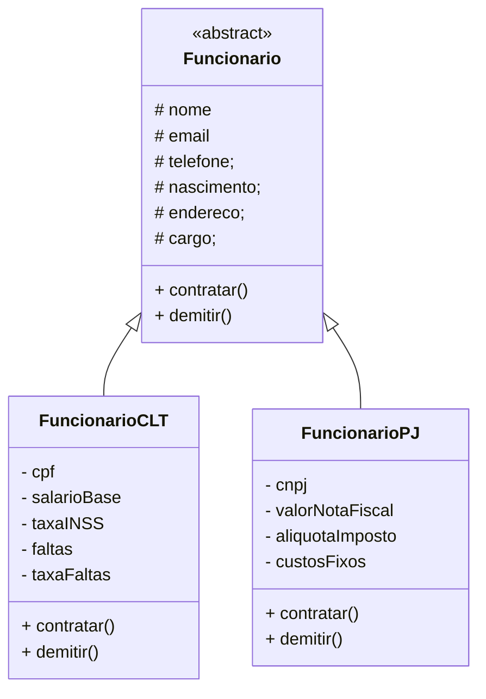

# S4_R1_AT1

## EXERCÍCIOS DE APROPRIAÇÃO

### 1. O que é uma interface?

Uma interface é um contrato que define quais métodos e propriedades uma classe deve ter. Assim, todo objeto criado a partir dessa classe garante que sabe executar aquelas ações.

### 2. Qual a diferença entre classe abstrata e interface?

Uma interface é um conjunto de regras que TODO objeto instanciado deve seguir, já uma classe abstrata é um molde em que se pode adicionar mais detalhes prontos, como atributos e métodos já implementados, além de regras que as classes filhas devem completar.

### 3. Por que interfaces ajudam no trabalho em equipe?

Pois padroniza todas as classes feitas que se baseiam nela

## DESAFIO PROFISSIONAL

### 1. Como interfaces ajudam ele a entender o sistema mais rápido?

Pois mostram todas as regras em que cada 'filho' deve seguir

### 2. O que acontece se ele não seguir o contrato?

Não é possível, pois retornaria erro, essa é a função da interface, padronizar

## Diagrama

